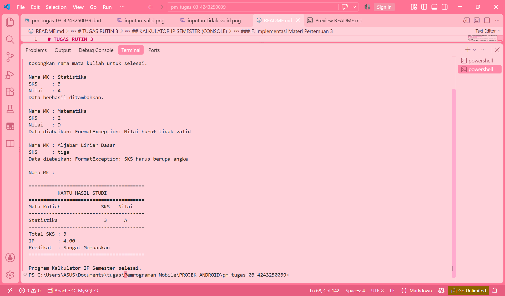
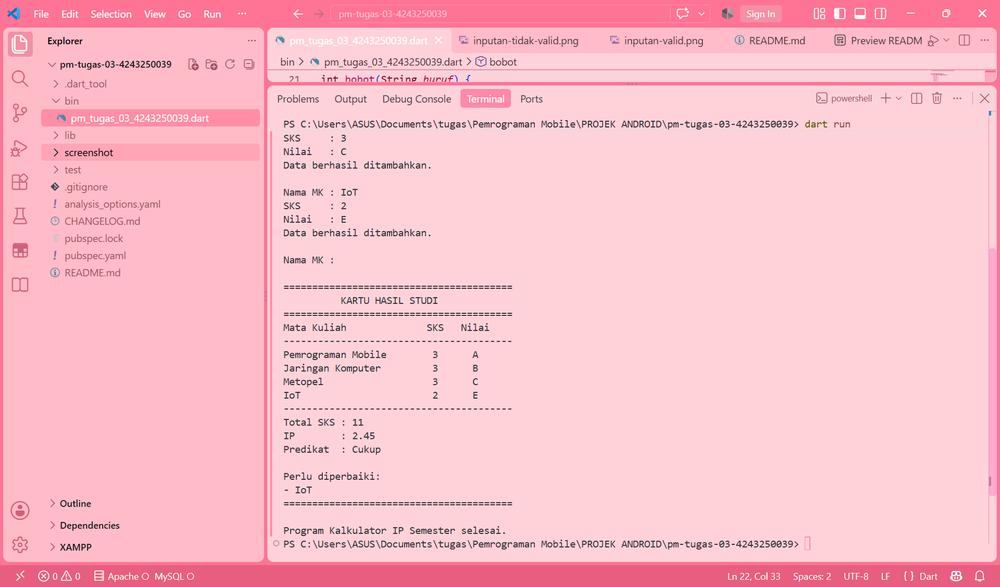

# TUGAS RUTIN 3
## KALKULATOR IP SEMESTER (CONSOLE)

### A. Identitas Mahasiswa

- **Nama:** Elga Sari Tanjung
- **NIM:** 4243250039
- **Kelas:** PSIK-24C
- **Pertemuan:** 3
- **Judul Tugas:** Kalkulator IP Semester (Console)

---

### B. Deskripsi Program

Program Kalkulator IP Semester merupakan aplikasi berbasis console yang dibuat menggunakan bahasa pemrograman Dart. Program ini bertujuan untuk menghitung Indeks Prestasi (IP) mahasiswa dalam satu semester berdasarkan data mata kuliah, jumlah SKS, dan nilai huruf yang dimasukkan oleh pengguna.

Pengguna dapat memasukkan beberapa mata kuliah secara berulang. Program akan menghitung total SKS, bobot nilai, IP semester, menentukan predikat, serta menampilkan mata kuliah yang perlu diperbaiki.

Program menggunakan sistem nilai huruf A, B, C, dan E sesuai dengan ketentuan penilaian yang digunakan di kampus.

### C. Fitur Program

1. Memasukkan nama mata kuliah.
2. Memasukkan jumlah SKS (1–6).
3. Memasukkan nilai huruf (A, B, C, dan E).
4. Mengubah nilai huruf menjadi bobot angka.
5. Menghitung total SKS.
6. Menghitung Indeks Prestasi (IP) semester.
7. Menentukan predikat IP.
8. Menampilkan mata kuliah dengan nilai rendah.
9. Mengurutkan mata kuliah berdasarkan nilai tertinggi.
10. Melakukan validasi input dan penanganan kesalahan.

### D. Konversi Nilai

| Nilai Huruf | Bobot |
|---|---:|
| A | 4 |
| B | 3 |
| C | 2 |
| E | 0 |

Nilai huruf selain A, B, C, dan E dianggap tidak valid.

### E. Screenshot Hasil Program

#### 1. Pengujian Input Tidak Valid

Pada pengujian ini, program menerima input SKS berupa huruf "tiga" dan nilai huruf "F". Kedua input tersebut tidak valid sehingga program menampilkan pesan kesalahan dan mengabaikan data tersebut tanpa menghentikan program.

#### 2. Pengujian Input Valid

Pada pengujian ini, program berhasil menerima data mata kuliah Pemrograman Mobile, Jaringan Komputer, dan Aljabar Linier Dasar. Seluruh data berhasil diproses dan program menampilkan total SKS sebanyak 8 dengan IP sebesar 4.00 serta predikat Sangat Memuaskan.

### F. Implementasi Materi Pertemuan 3

Program ini menerapkan beberapa materi yang telah dipelajari pada Pertemuan 3, yaitu control flow, functions, higher-order functions, dan error handling.

1. **Control Flow:** Program menggunakan `if-else` untuk percabangan, `switch` untuk menentukan bobot nilai, dan `while` untuk mengulang proses input mata kuliah sampai pengguna mengosongkan nama mata kuliah.

2. **Functions:** Program menggunakan beberapa fungsi, yaitu `bobot()`, `validasi()`, `hitungIp()`, `predikat()`, dan `cetakKhs()`. Setiap fungsi memiliki tugas masing-masing agar kode lebih terstruktur dan mudah dipahami.

3. **Higher-Order Functions:** Program menggunakan `fold` pada fungsi `hitungIp()` untuk menghitung total SKS dan total bobot nilai. Fungsi `where` digunakan pada `cetakKhs()` untuk mencari mata kuliah yang memiliki bobot di bawah 2. Selain itu, `sort` digunakan untuk mengurutkan mata kuliah berdasarkan nilai tertinggi dengan fungsi pembanding.

4. **Error Handling:** Program menggunakan `FormatException` pada fungsi `bobot()` dan `validasi()` untuk menangani nilai huruf dan SKS yang tidak sesuai. Selanjutnya, `try-catch` pada fungsi `main()` digunakan untuk menangkap kesalahan input sehingga data yang tidak valid dapat diabaikan tanpa menghentikan jalannya program.

### G. Kesimpulan

Berdasarkan hasil pengujian, program Kalkulator IP Semester berhasil dijalankan menggunakan bahasa pemrograman Dart. Program dapat menerima data mata kuliah, memvalidasi input, menghitung total SKS, menghitung IP semester, menentukan predikat, dan menampilkan mata kuliah yang perlu diperbaiki.

Pengujian juga menunjukkan bahwa program mampu menangani input yang tidak valid tanpa mengalami penghentian program. Dengan demikian, program telah menerapkan materi control flow, functions, higher-order functions, dan error handling sesuai dengan materi Pertemuan 3.

### H. Pernyataan Penggunaan AI

Dalam pengerjaan tugas ini, saya menggunakan AI sebagai alat bantu untuk memahami materi, dan menyusun kode program. Saya tetap melakukan pengujian dan menjalankan program secara mandiri menggunakan Visual Studio Code.

---